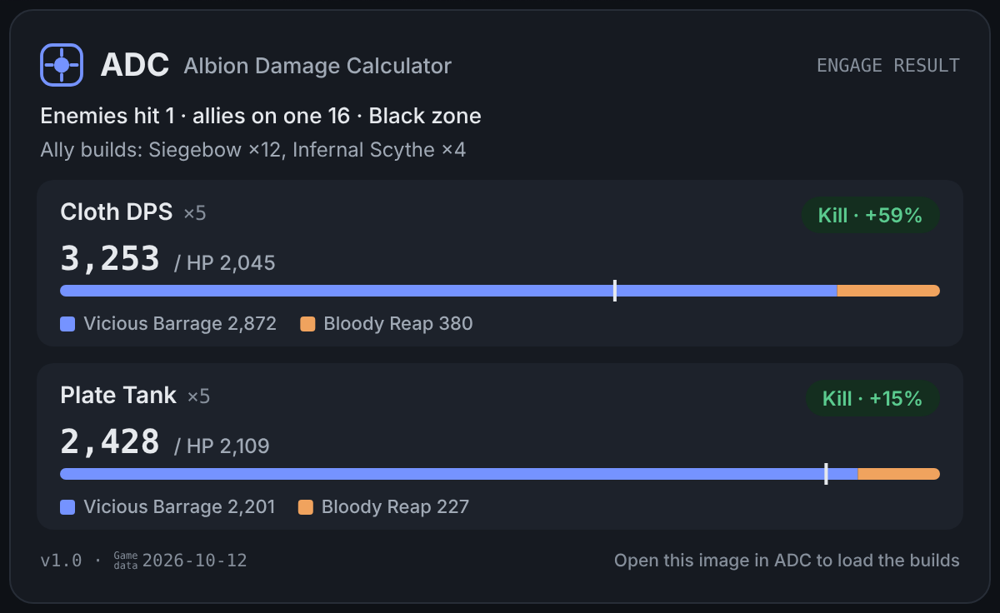

# ADC
**Albion Damage Calculator**

ZvZ engage damage calculator for Albion Online

[**⬇ Download the latest version**](https://github.com/godong02/ADC/releases/latest) · English / 한국어 / 中文

---

### What does it do?
ADC calculates in advance how much damage your zerg's engage can deal to the enemy, and whether it can kill them. Spell values and gear stats are the same as in the game.

### Getting started
1. Download `ADC.html` from **Download the latest version** above.
2. Double-click it to open it in your browser.

### Sharing
Share your result as an image, and anyone who loads it into ADC gets exactly the same setup you shared.

### FAQ
**Q. Do I need to install anything?**

No. It's a single HTML file, so just open it in your browser.

**Q. Which game data is it based on?**

The date is shown next to the ADC version.

**Q. How do I get new versions?**

When you open ADC, it tells you if a new version is available. Overwrite your old file with the new one and your builds stay as they are.

